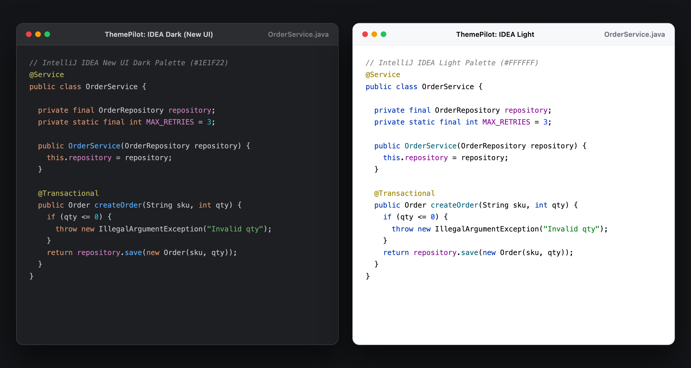

# ThemePilot

**Curated IDE-inspired color themes and typography presets for VS Code, Cursor, and Windsurf.**

## Included Themes

### IntelliJ IDEA Collection
- **ThemePilot: IDEA Dark (New UI)**: Modern IntelliJ IDEA New UI dark palette (`#1E1F22` editor, `#2B2D30` sidebar, bottom blue active tab bar, warm orange keywords, sky blue method declarations, soft green strings, italic purple static fields, olive annotations).
- **ThemePilot: IDEA Darcula (Classic)**: Classic IntelliJ Darcula palette (`#2B2B2B` editor, `#3C3F41` sidebar, amber methods, burnt orange keywords).
- **ThemePilot: IDEA Light**: Crisp IntelliJ Light palette (`#FFFFFF` editor, `#F7F8FA` sidebar, deep navy keywords, forest green strings).
- **ThemePilot: IDEA Icons**: Minimalist IntelliJ New UI file & folder icon theme (blue source roots, green test roots, purple config/resources, muted build dirs, and crisp language badges).

All themes enable **semantic highlighting** and are tuned for Java (Spring Boot), TypeScript, JavaScript, Python, Go, Rust, JSON, YAML, HTML, CSS, and Markdown.

## 1-Click Typography & Theme Commands

Open the Command Palette (`Cmd+Shift+P` / `Ctrl+Shift+P`):
- **`ThemePilot: Apply Full IntelliJ New UI Look & Feel`**: 1-click setup that activates `IDEA Dark (New UI)`, installs/applies bundled **JetBrains Mono** (`13px`, ligatures, `1.5` line height), disables VS Code's minimap and rainbow brackets, enables Sticky Scroll and full-line gutter highlight, and tightens tree indent.
- **`ThemePilot: Switch Theme`**: Quickly switch between installed ThemePilot color themes.
- **`ThemePilot: Apply IntelliJ Font & Ligatures (JetBrains Mono)`**: Installs the bundled offline **JetBrains Mono** font (Regular, Italic, Bold, Bold Italic, licensed under SIL OFL 1.1) and applies ligatures + line height without changing your other editor settings.
- **`ThemePilot: Reset IntelliJ Look & Feel Settings`**: Reverts all ThemePilot editor overrides back to VS Code defaults.

## Also by Pallattu
- **[ArchPilot](https://marketplace.visualstudio.com/items?itemName=Pallattu.archpilot-studio)**: Offline architecture, security, QA, upgrade planning, and AI token-cost guardrails for VS Code, Cursor, and Windsurf.
